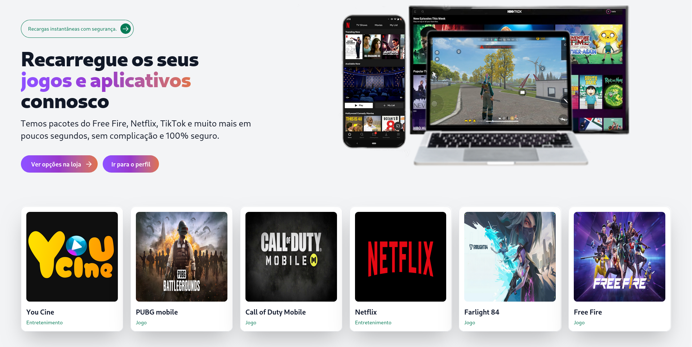

# Recarregaaki

Recarregaaki é uma plataforma angolana que permite comprar recarregas de serviços como Free Fire, Netflix e muito mais usando Kwanza.

## 🚀 Funcionalidades

- [ ] Website
- [ ] API
- [ ] Dashboard

## 🛠️ Tecnologias

- AdonisJS
- EdgeJS
- TailwindCSS
- Flowbite

## 📦 Instalação

```bash
# Clonar o repositório
git clone https://github.com/bigitfromdaao/recarregaaki-edgejs.git

# Entrar no diretório
cd recarregaaki-edgejs

# Instalar dependências
npm install

# Rodar o projeto
npm run dev
```

## 📸 Screenshots

<p align="center">
  
</p>

---

👤 **Autor**

- GitHub: [@bigitfromdaao](https://github.com/bigitfromdaao)

- LinkedIn: [Igor Teixeira](https://www.linkedin.com/in/teigorme/)
